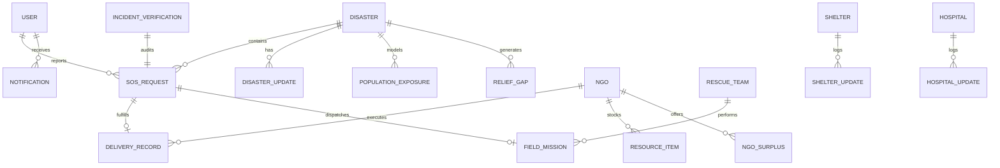

# ReliefLink — Database Schema & Data Models

## 1. Overview & Technology Selection

- **Database Engine**: PostgreSQL 16 with PostGIS extension for spatial queries.
- **ORM / Query Layer**: Prisma ORM with native geometry support and raw SQL spatial indexes (`GIST`).
- **Data Integrity**: Foreign key constraints, unique composite indexes, check constraints for planetary bounds (`-90 <= lat <= 90`, `-180 <= lng <= 180`), and database-level transactional locks for inventory allocations.

---

## 2. Entity Relationship Diagram (ERD)



---

## 3. Core Tables Specification

### `users`
- `id` (UUID, PK)
- `email` (VARCHAR(255), UNIQUE)
- `full_name` (VARCHAR(255))
- `phone` (VARCHAR(32))
- `roles` (VARCHAR[] — CITIZEN, VOLUNTEER, NGO_ADMIN, RESCUE_TEAM, HOSPITAL_ADMIN, SHELTER_ADMIN, GOVERNMENT_AUTHORITY, SUPER_ADMIN)
- `is_verified` (BOOLEAN)
- `is_active` (BOOLEAN)
- `created_at` (TIMESTAMPTZ)

### `disasters`
- `id` (VARCHAR(64), PK)
- `title` (VARCHAR(255))
- `type` (VARCHAR(64) — HURRICANE, FLOOD, EARTHQUAKE, LANDSLIDE, WILDFIRE, etc.)
- `severity` (VARCHAR(32) — LOW, MODERATE, HIGH, CRITICAL, CATASTROPHIC)
- `status` (VARCHAR(32) — REPORTED, VERIFIED, ACTIVE, CONTAINED, RESOLVED)
- `geom` (GEOMETRY(Point, 4326))
- `affected_radius_km` (FLOAT)
- `boundary_polygon` (GEOMETRY(Polygon, 4326), NULLABLE)
- `address` (TEXT)
- `started_at` (TIMESTAMPTZ)

### `sos_requests`
- `id` (VARCHAR(64), PK)
- `citizen_id` (UUID, FK -> users.id)
- `disaster_id` (VARCHAR(64), FK -> disasters.id)
- `type` (VARCHAR(64) — EVACUATION, MEDICAL, FOOD_WATER, RESCUE, SHELTER, OTHER)
- `severity` (VARCHAR(32) — LOW, MODERATE, HIGH, CRITICAL)
- `status` (VARCHAR(32) — PENDING, ACKNOWLEDGED, ASSIGNED, IN_PROGRESS, RESOLVED, CANCELLED)
- `geom` (GEOMETRY(Point, 4326))
- `address` (TEXT)
- `people_count` (INTEGER)
- `medical_needs` (TEXT)
- `is_duplicate` (BOOLEAN DEFAULT FALSE)
- `assigned_team_id` (VARCHAR(64), FK -> rescue_teams.id, NULLABLE)
- `created_at` (TIMESTAMPTZ)

### `delivery_records`
- `id` (VARCHAR(64), PK)
- `sos_id` (VARCHAR(64), FK -> sos_requests.id)
- `disaster_id` (VARCHAR(64), FK -> disasters.id)
- `ngo_id` (VARCHAR(64), FK -> ngos.id)
- `recipient_name` (VARCHAR(255))
- `recipient_address` (TEXT)
- `geom` (GEOMETRY(Point, 4326))
- `supplies` (JSONB — array of items, quantities, units, batch numbers)
- `status` (VARCHAR(32) — REQUESTED, VERIFIED, ASSIGNED, ACCEPTED, DISPATCHED, DELIVERED, CONFIRMED)
- `dispatched_at` (TIMESTAMPTZ, NULLABLE)
- `delivered_at` (TIMESTAMPTZ, NULLABLE)
- `confirmed_at` (TIMESTAMPTZ, NULLABLE)
- `responsible_personnel` (VARCHAR(255))
- `vehicle_registration` (VARCHAR(64), NULLABLE)
- `delivery_evidence_url` (TEXT, NULLABLE)
- `created_at` (TIMESTAMPTZ)

### `field_missions`
- `id` (VARCHAR(64), PK)
- `sos_id` (VARCHAR(64), FK -> sos_requests.id)
- `team_id` (VARCHAR(64), FK -> rescue_teams.id)
- `priority` (VARCHAR(32) — CRITICAL, HIGH, MODERATE)
- `geom` (GEOMETRY(Point, 4326))
- `status` (VARCHAR(32) — ASSIGNED, ACCEPTED, EN_ROUTE, ON_SCENE, RESCUED, COMPLETED)
- `tactical_orders` (TEXT)
- `hazards` (TEXT[])
- `arrival_confirmed_at` (TIMESTAMPTZ, NULLABLE)
- `completed_at` (TIMESTAMPTZ, NULLABLE)
- `evidence_notes` (TEXT, NULLABLE)

### `population_exposure`
- `id` (VARCHAR(64), PK)
- `district` (VARCHAR(128))
- `state` (VARCHAR(128))
- `total_residential_pop` (BIGINT)
- `estimated_exposed_pop` (BIGINT)
- `verified_affected_pop` (BIGINT)
- `confirmed_assisted_pop` (BIGINT)
- `confidence_score` (FLOAT)
- `data_source` (VARCHAR(255))
- `vintage_year` (INTEGER)
- `vulnerability_breakdown` (JSONB — elderly, children, medicalNeeds)
- `last_updated` (TIMESTAMPTZ)

### `relief_gaps`
- `id` (VARCHAR(64), PK)
- `sector_id` (VARCHAR(64))
- `sector_name` (VARCHAR(255))
- `district` (VARCHAR(128))
- `geom` (GEOMETRY(Point, 4326))
- `exposed_pop` (BIGINT)
- `unfulfilled_requests_count` (INTEGER)
- `delivered_supplies_percent` (FLOAT)
- `assigned_ngos_count` (INTEGER)
- `severity_level` (VARCHAR(32))
- `gap_type` (VARCHAR(32))
- `recommendations` (TEXT)
- `last_assessed_at` (TIMESTAMPTZ)

---

## 4. Spatial Indexes
```sql
CREATE INDEX idx_disasters_geom ON disasters USING GIST (geom);
CREATE INDEX idx_sos_geom ON sos_requests USING GIST (geom);
CREATE INDEX idx_deliveries_geom ON delivery_records USING GIST (geom);
CREATE INDEX idx_rescue_teams_geom ON rescue_teams USING GIST (geom);
CREATE INDEX idx_shelters_geom ON shelters USING GIST (geom);
CREATE INDEX idx_hospitals_geom ON hospitals USING GIST (geom);
```
